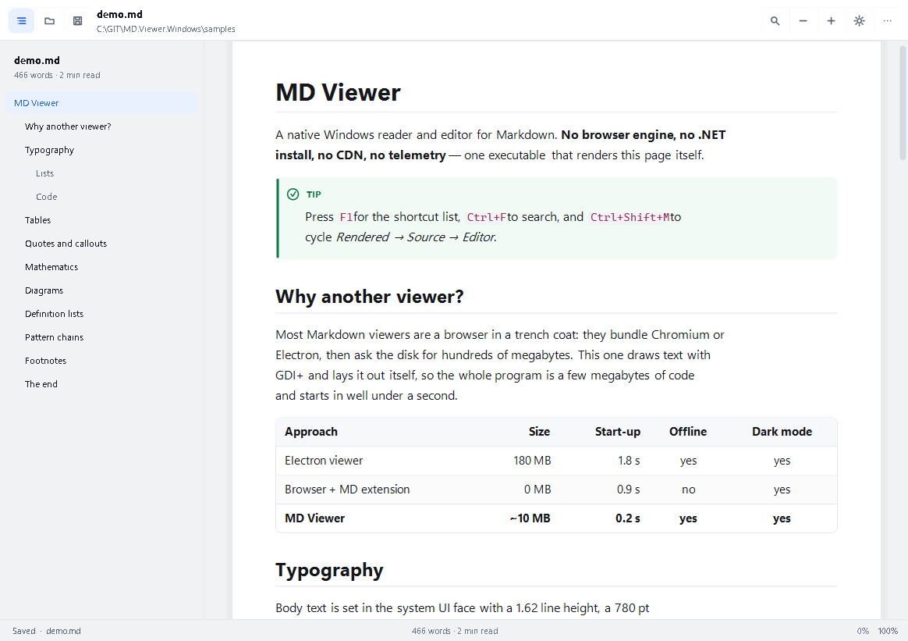
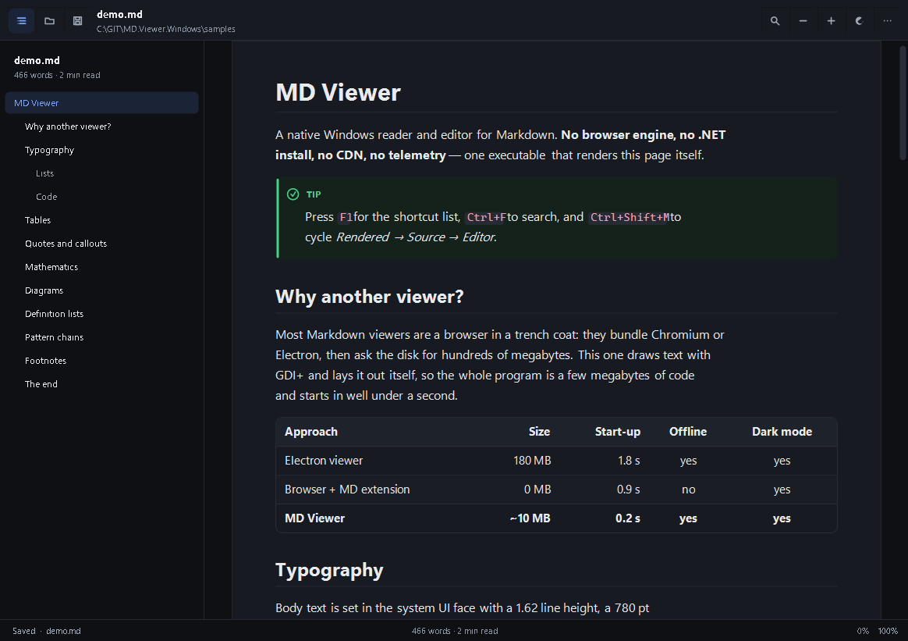
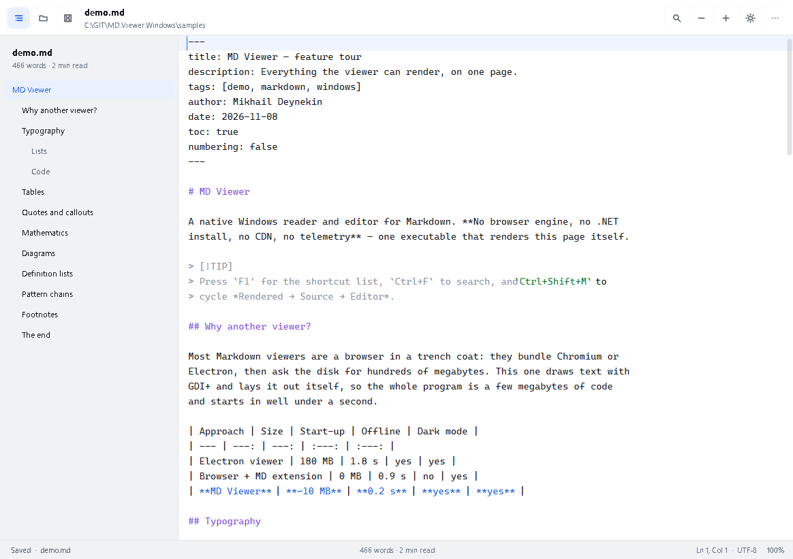

# MD Viewer for Windows

> A native Markdown reader and editor for Windows 10/11 — **no browser engine, no .NET install,
> no CDN, no telemetry**. One self-contained `mdview.exe` that lays out and paints Markdown itself.

[](#requirements)
[](#c-15)
[](#what-it-deliberately-does-not-do)
[](docs/TESTING.md)
[](LICENSE)

**Read this in:** English · [Русский](README.ru.md)



---

## What it is

A Markdown viewer that behaves like a native Windows application, because it is one: a WinForms
shell over a hand-written Markdown engine and a hand-written layout/paint pipeline, both drawing
through GDI+.

Most "Markdown viewers" are a browser in a trench coat. This one measures every glyph itself, so
it starts in well under a second, uses no RAM beyond its own layout, and renders identically in
light and dark mode without a single web asset.

| | |
| --- | --- |
| **Three view modes** | Rendered · Source (read-only, highlighted) · Editor (with optional live preview) |
| **Two themes** | Light and dark, plus *follow Windows* (`Ctrl+Shift+L` cycles) |
| **Tabs** | Open several documents; per-document scroll, caret and mode state |
| **Outline** | Heading sidebar with scroll-spy, click to jump, `Ctrl+\` to toggle |
| **Find** | `Ctrl+F` in every mode, with match count and next/previous |
| **Zoom** | `Ctrl+wheel`, `Ctrl+plus/minus`, 60 %…260 %, remembered per session |
| **Export** | Standalone HTML, plain text, PNG, Markdown copy — and Print (`Ctrl+P`) |
| **Command line** | File, mode, theme, zoom, width, line, anchor, print, export, screenshot |
| **Live reload** | Watches the file on disk and reloads it when it changes |



---

## Requirements

* Windows 10 1809+ or Windows 11 (x64).
* **Nothing else.** The shipped `mdview.exe` is self-contained: no .NET runtime, no WebView2, no
  Visual C++ redistributable, no fonts to install (it uses Segoe UI / Consolas / Cambria, which
  ship with Windows).

---

## Quick start

```powershell
# open a file
.\mdview.exe notes.md

# open it in the editor, dark, zoomed to 125 %, scrolled to line 40
.\mdview.exe notes.md --mode editor --theme dark --zoom 1.25 --line 40

# export a standalone HTML next to the source
.\mdview.exe notes.md --export html

# print the rendered document (dialog, choose "Microsoft Print to PDF")
.\mdview.exe notes.md --print
```

Launching with no arguments restores the previous session (up to 8 tabs); `--no-session` starts
empty. Dragging `.md` files onto the window opens them in new tabs.

---

## View modes

| Mode | Shortcut | What you get |
| --- | --- | --- |
| **Rendered** | `Ctrl+R` | The laid-out document: typography, tables, callouts, code cards, diagrams |
| **Source** | `Ctrl+U` | The raw Markdown, read-only, syntax-coloured, with line numbers |
| **Editor** | `Ctrl+E` | A real editor: soft wrap, block indent, list continuation, undo, find, `Ctrl+B/I/K` |

`Ctrl+Shift+M` cycles through the three. In editor mode `Ctrl+Shift+P` splits the window into
editor + live preview; the preview re-renders 220 ms after you stop typing.



---

## Markdown support

CommonMark core plus the GFM and MD.Scribe extensions. The full matrix, including what degrades
gracefully, is in **[docs/MARKDOWN.md](docs/MARKDOWN.md)**.

* Headings (ATX/setext, `{#id}`, numbering), emphasis, strike, mark, sub/superscript, code spans
* Fenced code with `title="…"`, indented code, language-aware highlighting for ~20 language
  families, copy button per block
* Tables with per-column alignment; two-column tables render as glossaries
* Lists: nested, ordered with start values, task lists with checkboxes
* Block quotes, GitHub alerts (`> [!NOTE]` … `> [!CAUTION]`), definition lists
* Footnotes (reference and inline), `[TOC]`, YAML front matter, emoji shortcodes
* Math: `$inline$` and `$$display$$` through a TeX-subset typesetter
* Mermaid flowcharts (`graph TD/LR`) rendered natively — boxes, diamonds, arrows, edge labels;
  anything else falls back to a readable source card with a diagnostic
* Images resolved relative to the document, captions from alt text, graceful placeholder when a
  file is missing; links to other `.md` files open in a new tab

Raw HTML in a document is **never executed** — it is shown as source in a labelled card. That is
a security decision, not a missing feature.

---

## Command line

```
mdview [file.md] [options]
```

| Option | Meaning |
| --- | --- |
| `--mode render\|source\|editor` | Start in a view mode |
| `--theme light\|dark\|auto` | Colour theme (`auto` follows Windows) |
| `--zoom 1.25` / `125%` / `+10%` | Zoom factor |
| `--width <px>` | Reading column width (380…2400) |
| `--toc` / `--no-toc` | Show or hide the outline sidebar |
| `--line-numbers` / `--no-line-numbers` | Line numbers in source/editor |
| `--wrap` / `--no-wrap` | Wrap long code lines |
| `--serif` / `--sans` | Reading font family |
| `--numbering` | Number the headings |
| `--line <n>`, `--anchor <id>` | Jump to a line or a heading anchor |
| `--maximized`, `--fullscreen` | Window state |
| `--watch` / `--no-watch` | Reload on file change |
| `--export html\|text\|png\|md`, `--out <file>` | Headless export (no window) |
| `--print` | Open the print dialog |
| `--lang ru\|en` | Interface language |
| `--no-session` | Ignore the saved session |
| `--reset-settings` | Restore defaults and exit |
| `--diagnostics` | Print fonts, DPI, theme and settings path |
| `--screenshot <file>` | Capture the live window (development, see docs/TESTING.md) |
| `--version`, `--help` | Version / this list |

Exit codes: `0` success, `2` bad arguments or missing input.

---

## Keyboard

```
Ctrl+O open · Ctrl+S save · Ctrl+Shift+S save as · F5 reload
Ctrl+R rendered · Ctrl+U source · Ctrl+E editor · Ctrl+Shift+M cycle
Ctrl+F find · F3 find again · Esc close find
Ctrl+W close tab · Ctrl+T new tab · Ctrl+Tab next tab
Ctrl+plus / Ctrl+minus / Ctrl+0 zoom · Ctrl+Shift+L theme
Ctrl+\ outline · Ctrl+Shift+P editor preview · Ctrl+P print · F1 shortcuts
```

---

## Design notes

The interface is a deliberately small design system rather than a pile of default controls:
an 8-pt spacing rhythm, one accent colour, two neutral scales, a 32 px toolbar, a reading sheet
with real margins, and a type scale that keeps the measure between 60 and 85 characters.
Every colour pair that carries text is checked for WCAG contrast in the test suite, so a palette
tweak cannot silently make a label unreadable.

Details, tokens and the reasoning: **[docs/DESIGN.md](docs/DESIGN.md)**.

---

## C# 15

The app targets `net11.0-windows` and is written in C# 15. Three of its features are used for
real, not for show:

* **Union types** — `FrontMatterValue` is a union of `string`, `IReadOnlyList<string>`, `bool` and
  `long`; front-matter parsing and rendering switch over it exhaustively.
* **Closed hierarchies** — the Markdown AST roots (`Block`, `Inline`) are `closed`, so every
  `switch` in the renderer and the HTML exporter is compiler-checked for exhaustiveness.
* **Collection-expression arguments** — hot lists are created as
  `List<Block> output = [with(capacity: blocks.Length + 2)];` instead of a separate allocation call.

---

## Build from source

```powershell
# .NET 11 SDK (C# 15) required — see docs/BUILD.md for the exact version and the
# two environment quirks this workspace has.
pwsh -File build/build.ps1 -Task test      # build + 110 checks
pwsh -File build/build.ps1 -Task publish   # artifacts/publish/mdview.exe (self-contained)
```

Project layout:

```
src/MdViewer.Core     Markdown parser, AST, highlighter, Mermaid parser, exporters
src/MdViewer.Render   Theme tokens, text shaping, layout, painting
src/MdViewer.App      WinForms shell: window, views, editor, chrome, CLI
src/MdViewer.Tests    Headless test runner + snapshot and UI smoke tools
docs/                 Architecture, Markdown matrix, CLI, design, testing, build
samples/              Feature tour and a Russian typography sample
```

---

## What it deliberately does not do

* **No network access at all.** No update checks, no telemetry, no remote images, no CDN fonts.
  A remote image is reported as "not loaded (offline viewer)" instead of being fetched.
* **No HTML/JavaScript execution.** Documents cannot run code inside the viewer.
* **No plugin system.** The feature set is the feature set.
* **Mermaid is flowcharts only.** Sequence, class, gantt and pie diagrams show their source with a
  clear note; a wrong diagram never breaks the page.
* **Math is a TeX subset**, not LaTeX: fractions, roots, sums, Greek letters, sub/superscripts.
  Unknown commands render as literal text rather than an error.

---

## License

PolyForm Noncommercial License 1.0.0 — see [LICENSE](LICENSE).

