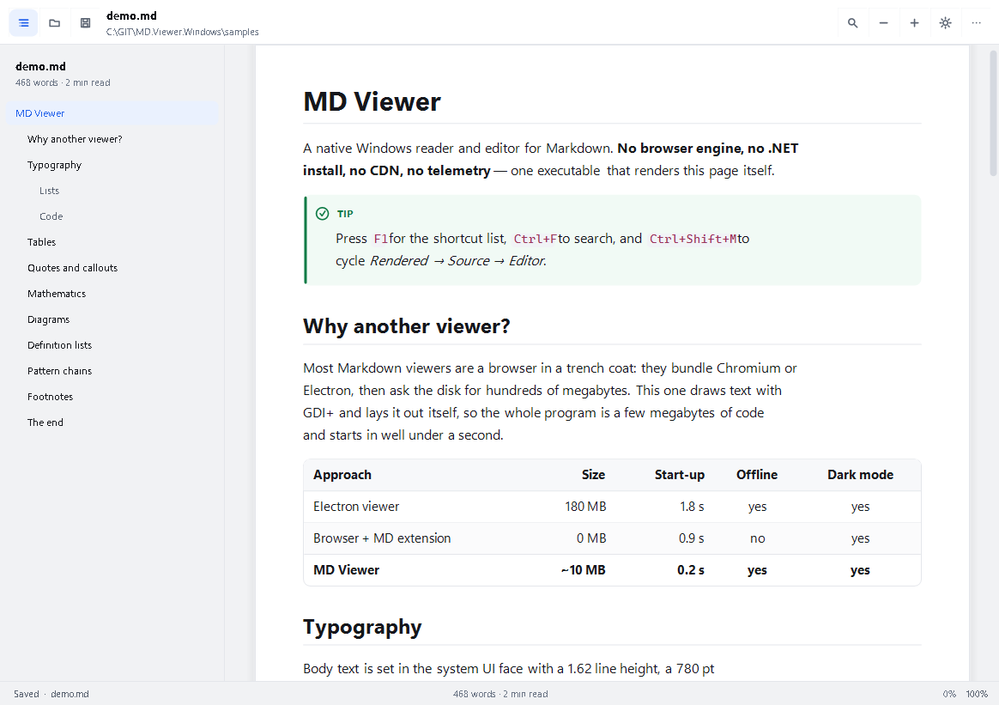
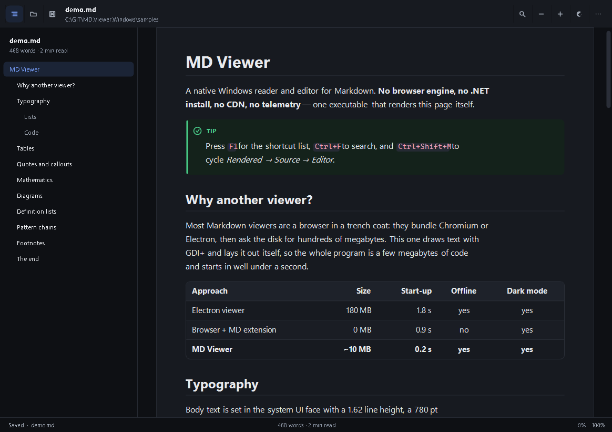
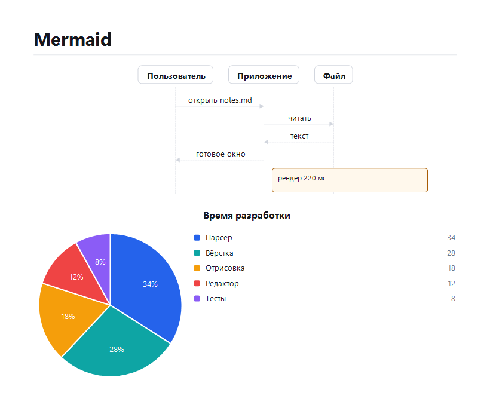

# MD Viewer для Windows

> Нативный просмотрщик и редактор Markdown для Windows 10/11 — **без браузерного движка, без
> установки .NET, без CDN и без телеметрии**. Один самодостаточный `mdview.exe`, который сам
> раскладывает и рисует Markdown.

[](#требования)
[](#c-15)
[](#чего-он-сознательно-не-делает)
[](docs/TESTING.md)
[](LICENSE)

**Read this in:** [English](README.md) · Русский



---

## Что это

Просмотрщик Markdown, который ведёт себя как родное приложение Windows, потому что он им и
является: оболочка WinForms поверх собственного движка Markdown и собственного конвейера
вёрстки и отрисовки — всё через GDI+.

Большинство «просмотрщиков Markdown» — это браузер в плаще. Этот измеряет каждый глиф сам,
поэтому стартует заметно быстрее секунды, не тянет за собой память браузера и одинаково
аккуратно выглядит в светлой и тёмной теме без единого веб-ассета.

| | |
| --- | --- |
| **Три режима** | Просмотр · Исходник (только чтение, с подсветкой) · Редактор (с живым просмотром) |
| **Две темы** | Светлая и тёмная плюс «как в Windows» (`Ctrl+Shift+L` переключает) |
| **Вкладки** | Несколько документов, у каждого свой скролл, каретка и режим |
| **Оглавление** | Боковая панель заголовков со слежением за прокруткой, `Ctrl+\` |
| **Поиск** | `Ctrl+F` в любом режиме, счётчик совпадений, переход вперёд/назад |
| **Масштаб** | `Ctrl+колесо`, `Ctrl+плюс/минус`, 60 %…260 %, запоминается |
| **Экспорт** | Автономный HTML, обычный текст, PNG, копия Markdown — и печать (`Ctrl+P`) |
| **Командная строка** | Файл, режим, тема, масштаб, ширина, строка, якорь, печать, экспорт, скриншот |
| **Живая перезагрузка** | Следит за файлом на диске и перечитывает его |



---

## Требования

* Windows 10 1809+ или Windows 11 (x64).
* **Больше ничего.** Поставляемый `mdview.exe` самодостаточен: не нужен ни .NET, ни WebView2, ни
  распространяемый пакет Visual C++, ни установка шрифтов (используются Segoe UI, Consolas и
  Cambria, которые уже есть в Windows).

---

## Быстрый старт

```powershell
# открыть файл
.\mdview.exe notes.md

# открыть в редакторе, тёмная тема, масштаб 125 %, сразу на 40-й строке
.\mdview.exe notes.md --mode editor --theme dark --zoom 1.25 --line 40

# выгрузить автономный HTML рядом с исходником
.\mdview.exe notes.md --export html

# печать отрисованного документа (в диалоге выбрать «Microsoft Print to PDF»)
.\mdview.exe notes.md --print
```

Запуск без аргументов восстанавливает прошлую сессию (до 8 вкладок); `--no-session` открывает
пустое окно. Файлы `.md`, перетащенные в окно, открываются новыми вкладками.

---

## Режимы

| Режим | Клавиши | Что показывает |
| --- | --- | --- |
| **Просмотр** | `Ctrl+R` | Свёрстанный документ: типографика, таблицы, врезки, блоки кода, схемы |
| **Исходник** | `Ctrl+U` | Исходный Markdown, только чтение, с подсветкой и номерами строк |
| **Редактор** | `Ctrl+E` | Полноценный редактор: перенос строк, отступы блоками, продолжение списков, отмена, поиск, `Ctrl+B/I/K` |

`Ctrl+Shift+M` перебирает режимы. В редакторе `Ctrl+Shift+P` делит окно на редактор и живой
просмотр; просмотр перерисовывается через 220 мс после последнего нажатия.

---

## Поддержка Markdown

Ядро CommonMark плюс расширения GFM и MD.Scribe. Полная матрица, включая то, что деградирует
аккуратно, — в **[docs/MARKDOWN.md](docs/MARKDOWN.md)**.

* Заголовки (ATX/setext, `{#id}`, нумерация), выделения, зачёркивание, маркер, верхний и нижний
  индекс, код в строке
* Блоки кода с `title="…"`, отступный код, подсветка для ~20 языковых семейств, кнопка копирования
* Таблицы с выравниванием по колонкам; таблицы из двух колонок работают как глоссарий
* Списки: вложенные, нумерованные с начальным номером, чек-листы
* Цитаты, врезки GitHub (`> [!NOTE]` … `> [!CAUTION]`), списки определений
* Сноски (ссылочные и встроенные), `[TOC]`, YAML front matter, эмодзи-коды
* Формулы: `$в строке$` и `$$блок$$` через наборщик подмножества TeX
* Схемы Mermaid рисуются нативно — `flowchart`/`graph`, `sequenceDiagram`, `pie`, `classDiagram`,
  `stateDiagram-v2`, `gantt` и `journey`; неподдерживаемые типы показываются исходником с
  пояснением, а не ломают страницу



Сырой HTML **никогда не исполняется** — он показывается исходником в отдельной карточке. Это
решение по безопасности, а не недостаток.

---

## Командная строка

| Опция | Значение |
| --- | --- |
| `--mode render\|source\|editor` | Режим при старте |
| `--theme light\|dark\|auto` | Тема (`auto` — как в Windows) |
| `--zoom 1.25` / `125%` / `+10%` | Масштаб |
| `--width <px>` | Ширина колонки чтения (380…2400) |
| `--toc` / `--no-toc` | Показать/скрыть оглавление |
| `--line-numbers` / `--no-line-numbers` | Номера строк |
| `--wrap` / `--no-wrap` | Перенос длинных строк кода |
| `--serif` / `--sans` | Шрифт с засечками или без |
| `--numbering` | Нумеровать заголовки |
| `--line <n>`, `--anchor <id>` | Перейти к строке или заголовку |
| `--maximized`, `--fullscreen` | Состояние окна |
| `--watch` / `--no-watch` | Перечитывать при изменении файла |
| `--export html\|text\|png\|md`, `--out <file>` | Экспорт без окна |
| `--print` | Диалог печати |
| `--lang ru\|en` | Язык интерфейса |
| `--no-session` | Не восстанавливать сессию |
| `--reset-settings` | Сбросить настройки и выйти |
| `--diagnostics` | Шрифты, DPI, тема, путь настроек |
| `--version`, `--help` | Версия / справка |

Коды выхода: `0` — успех, `2` — неверные аргументы или отсутствующий файл.

---

## Горячие клавиши

```
Ctrl+O открыть · Ctrl+S сохранить · Ctrl+Shift+S сохранить как · F5 перечитать
Ctrl+R просмотр · Ctrl+U исходник · Ctrl+E редактор · Ctrl+Shift+M сменить режим
Ctrl+F поиск · F3 искать снова · Esc закрыть поиск
Ctrl+W закрыть вкладку · Ctrl+T новая вкладка · Ctrl+Tab следующая
Ctrl+плюс / Ctrl+минус / Ctrl+0 масштаб · Ctrl+Shift+L тема
Ctrl+\ оглавление · Ctrl+Shift+P просмотр в редакторе · Ctrl+P печать · F1 справка
```

---

## Оформление

Интерфейс — намеренно небольшая дизайн-система, а не набор стандартных контролов: шаг сетки
8 pt, один акцентный цвет, две нейтральные шкалы, панель 32 px, «лист» чтения с настоящими
полями и шкала кеглей, которая держит строку в пределах 60–85 символов. Каждая пара цветов, на
которой есть текст, проверяется на контраст WCAG в тестах — палитру нельзя испортить незаметно.

Подробности и токены: **[docs/DESIGN.md](docs/DESIGN.md)**.

---

## C# 15

Проект собирается под `net11.0-windows` на C# 15. Три возможности языка используются по делу:

* **Типы объединения** — `FrontMatterValue` объединяет `string`, `IReadOnlyList<string>`, `bool`
  и `long`; разбор и вывод front matter идут через исчерпывающий `switch`.
* **Закрытые иерархии** — корни AST (`Block`, `Inline`) объявлены `closed`, поэтому все
  `switch` в рендерере и HTML-экспортёре проверены компилятором на полноту.
* **Аргументы выражения коллекции** — горячие списки создаются как
  `List<Block> output = [with(capacity: blocks.Length + 2)];`.

---

## Сборка

```powershell
# нужен .NET 11 SDK (C# 15) — точная версия и две ловушки окружения в docs/BUILD.md
pwsh -File build/build.ps1 -Task test      # сборка + 121 проверка
pwsh -File build/build.ps1 -Task publish   # artifacts/publish/mdview.exe (самодостаточный)
```

Структура:

```
src/MdViewer.Core     парсер Markdown, AST, подсветка, парсер Mermaid, экспортёры
src/MdViewer.Render   токены темы, формирование строк, вёрстка, отрисовка
src/MdViewer.App      оболочка WinForms: окно, режимы, редактор, панели, CLI
src/MdViewer.Tests    тестовый прогон + инструменты снимков и UI-смоука
docs/                 архитектура, матрица Markdown, CLI, дизайн, тесты, сборка
samples/              экскурсия по функциям и образец русской типографики
```

---

## Чего он сознательно не делает

* **Никакой сети.** Ни проверок обновлений, ни телеметрии, ни внешних картинок, ни CDN-шрифтов.
  Внешняя картинка помечается как «не загружена (офлайн)», а не скачивается.
* **Не исполняет HTML и JavaScript.** Документ не может запустить код внутри просмотрщика.
* **Нет плагинов.** Набор функций — это набор функций.
* **Mermaid покрывает семь типов.** `erDiagram`, `gitGraph`, `mindmap`, `timeline`, `quadrantChart`,
  `sankey`, `xychart`, `C4` и `block` показывают исходник с пояснением; непонятая схема никогда не
  ломает страницу.
* **Математика — подмножество TeX**, а не LaTeX: дроби, корни, суммы, греческие буквы, индексы.
  Неизвестные команды выводятся как текст, а не как ошибка.

---

## Лицензия

PolyForm Noncommercial License 1.0.0 — см. [LICENSE](LICENSE).


