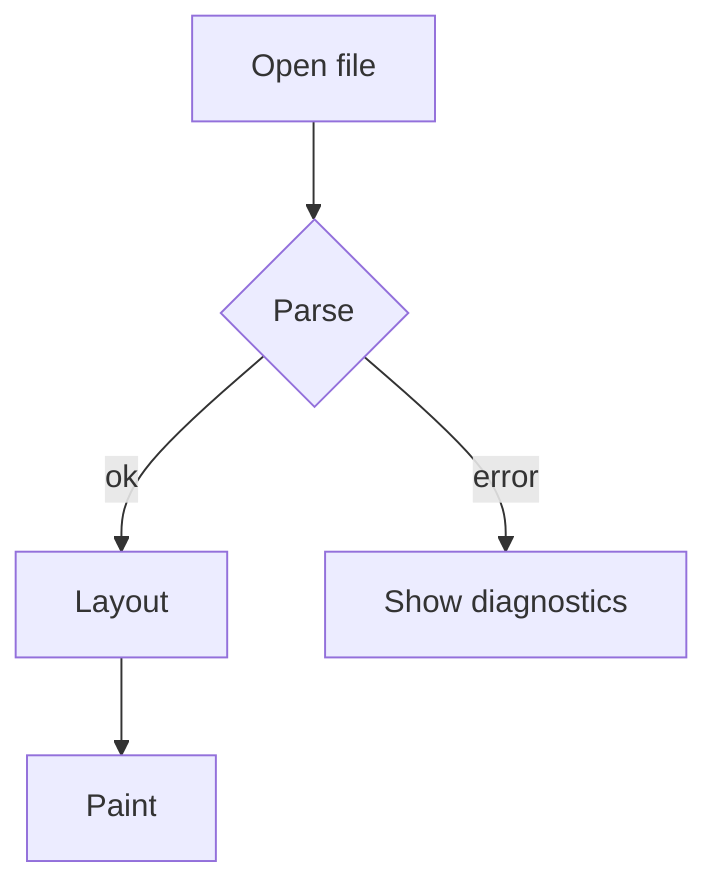

# MD Viewer

A native Windows reader and editor for Markdown. **No browser engine, no .NET
install, no CDN, no telemetry** — one executable that renders this page itself.

> [!TIP]
> Press `F1` for the shortcut list, `Ctrl+F` to search, and `Ctrl+Shift+M` to
> cycle *Rendered → Source → Editor*.

## Why another viewer?

Most Markdown viewers are a browser in a trench coat: they bundle Chromium or
Electron, then ask the disk for hundreds of megabytes. This one draws text with
GDI+ and lays it out itself, so the whole program is a few megabytes of code
and starts in well under a second.

| Approach | Size | Start-up | Offline | Dark mode |
| --- | ---: | ---: | :---: | :---: |
| Electron viewer | 180 MB | 1.8 s | yes | yes |
| Browser + MD extension | 0 MB | 0.9 s | no | yes |
| **MD Viewer** | **~10 MB** | **0.2 s** | **yes** | **yes** |

## Typography

Body text is set in the system UI face with a 1.62 line height, a 780 pt
measure and generous margins, because a line of text that runs from edge to
edge is a line nobody reads.

Inline styles work as expected: *italic*, **bold**, ***both***, ~~struck~~,
==marked==, H~2~O, x^2^, `inline code`, and a [link to the docs](#typography).

### Lists

1. Ordered lists keep their start number.
2. They nest:

   - second level
   - another item
     - third level

3. And mix with paragraphs.

- [x] Task lists are supported
- [ ] So are unchecked boxes
- [ ] And `[!NOTE]` callouts

### Code

```csharp
// C# 15 — the language this app is written in
public union Cell(string, int, bool);

public closed record class Node;
public record class Leaf(string Text) : Node;

var items = [with(capacity: 64), .. existing];
```

```powershell
# PowerShell
Get-ChildItem -Path .\docs -Filter *.md -Recurse |
    ForEach-Object { $_.FullName }
```

```
Plain text blocks stay plain — no highlighting guesses.
```

## Tables

| Feature | Rendered | Notes |
| :-- | :-: | --: |
| Tables | yes | alignment per column |
| Footnotes | yes | with back-links |
| Math | yes[^math] | TeX subset |
| Diagrams | partial | Mermaid source shown |

## Quotes and callouts

> A block quote keeps its own rhythm: quieter colour, a bar, and the same line
> height as body text.

> [!WARNING]
> Callouts come in five flavours — note, tip, important, warning, caution —
> and they accept **full Markdown** inside.

> [!NOTE]
> Everything here is drawn natively: no HTML, no script, no hidden web view.

## Mathematics

Inline math such as $e^{i\pi} + 1 = 0$ flows with the sentence, and display
math gets its own centred block:

$$
\int_{-\infty}^{\infty} e^{-x^2}\,dx = \sqrt{\pi}
$$

## Diagrams



## Definition lists

Renderer
: The part that turns blocks into pixels.

Layout
: The measured geometry a frame is painted from.

## Pattern chains

Chains written as code spans become a small graphic:
`(Client) --> [HTTPS] --> (Server)`.

## Footnotes

Footnotes are collected at the bottom of the document.[^one] They keep their
own paragraphs, links and emphasis.[^two]

[^one]: First note — with a [link](https://example.com).
[^two]: Second note with *emphasis*.

## The end

That is the whole tour. Open your own file with `Ctrl+O`, or drag one onto the
window.
