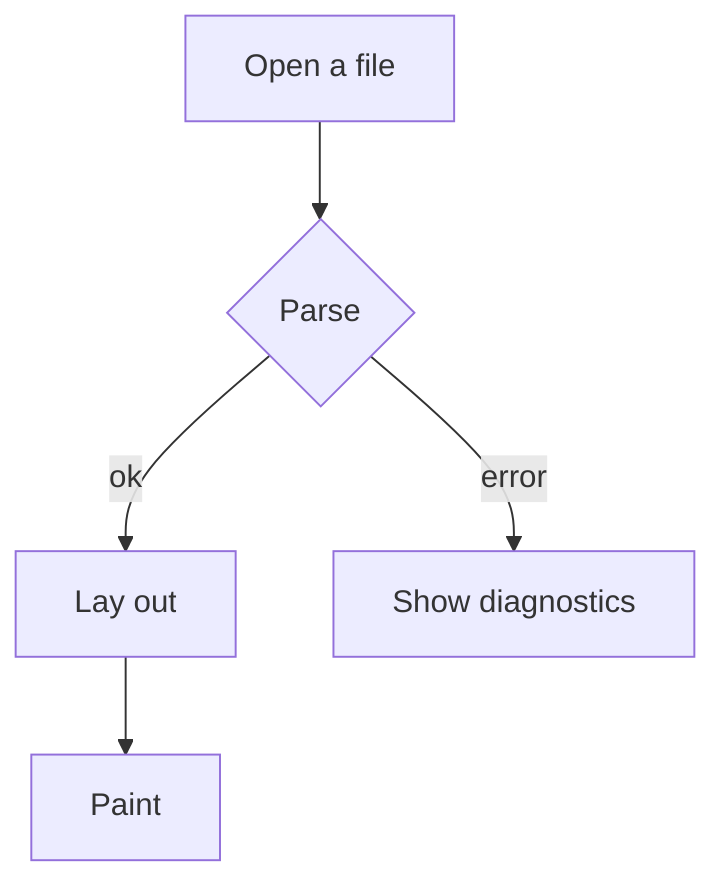
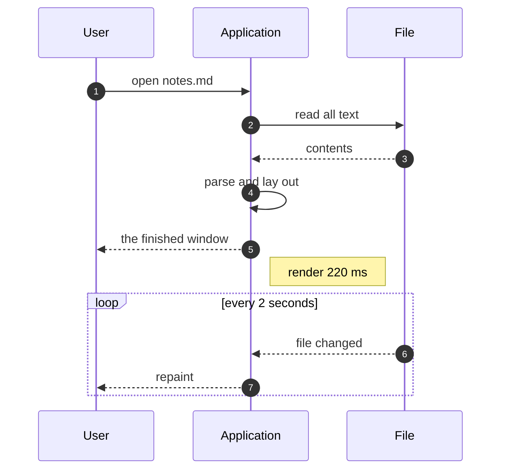
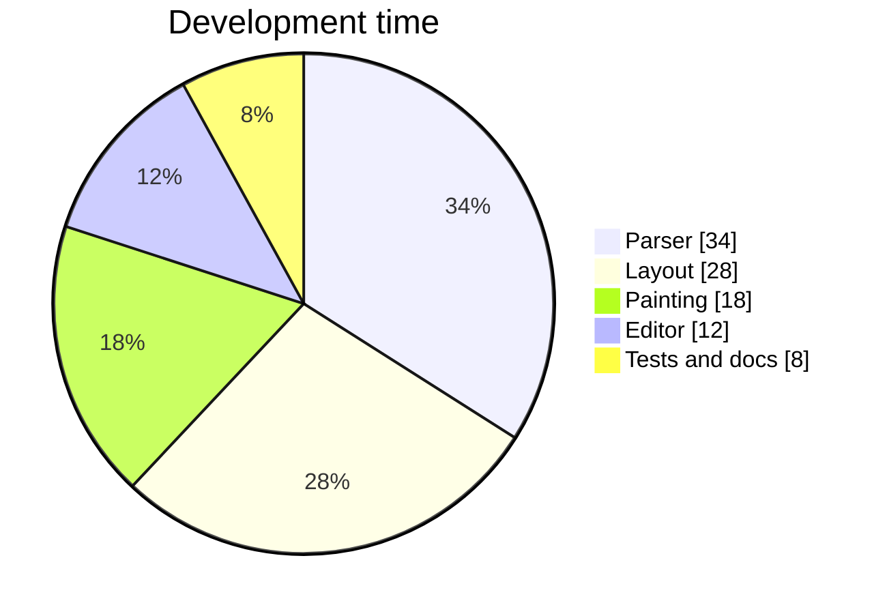
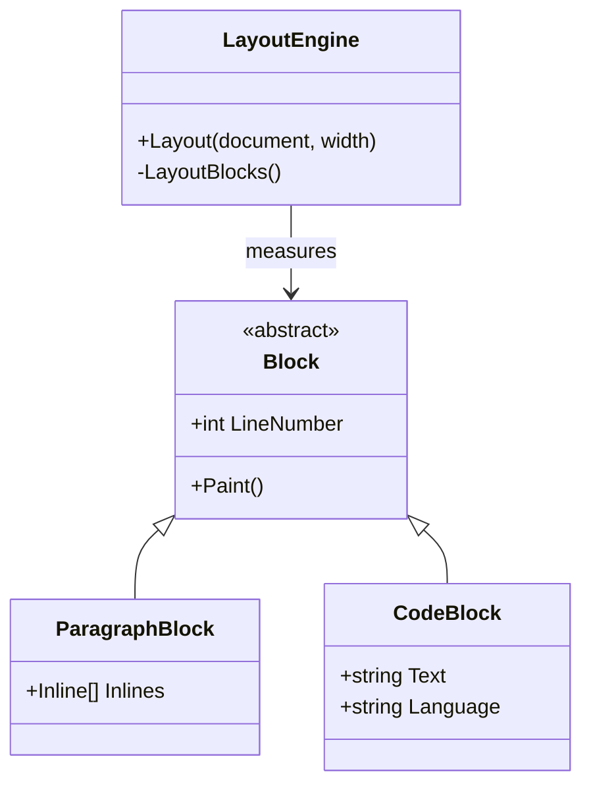
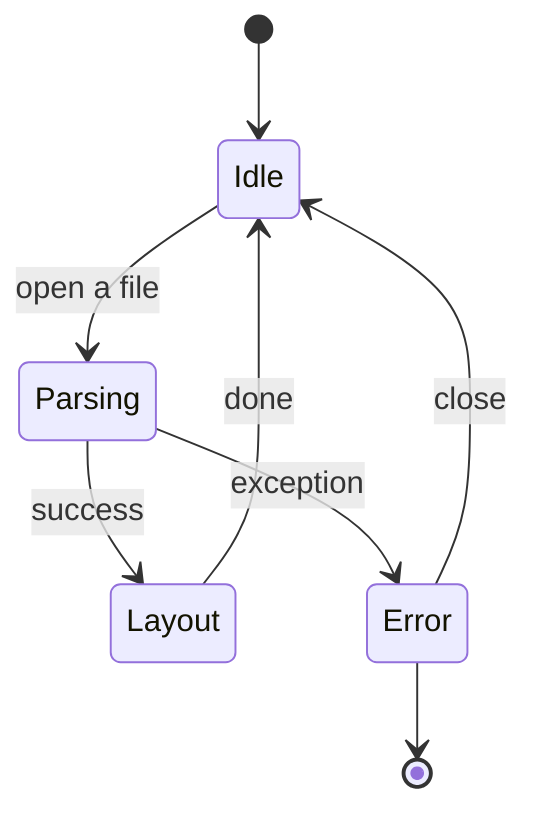
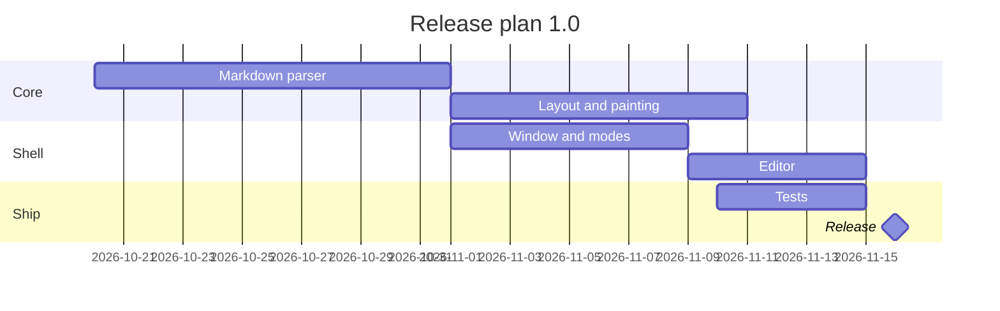
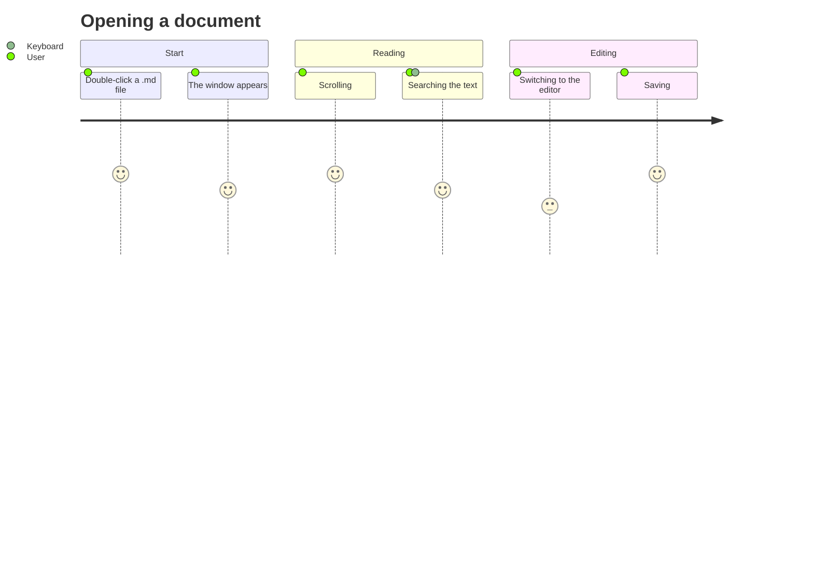
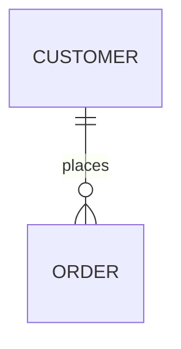

# Mermaid — everything that is supported

## Flowchart (graph / flowchart)

## Sequence diagram

## Pie chart

## Class diagram

## State diagram

## Gantt chart

## User journey

## What is not supported

Such types are shown as their source with an explanation — and never break the page.
