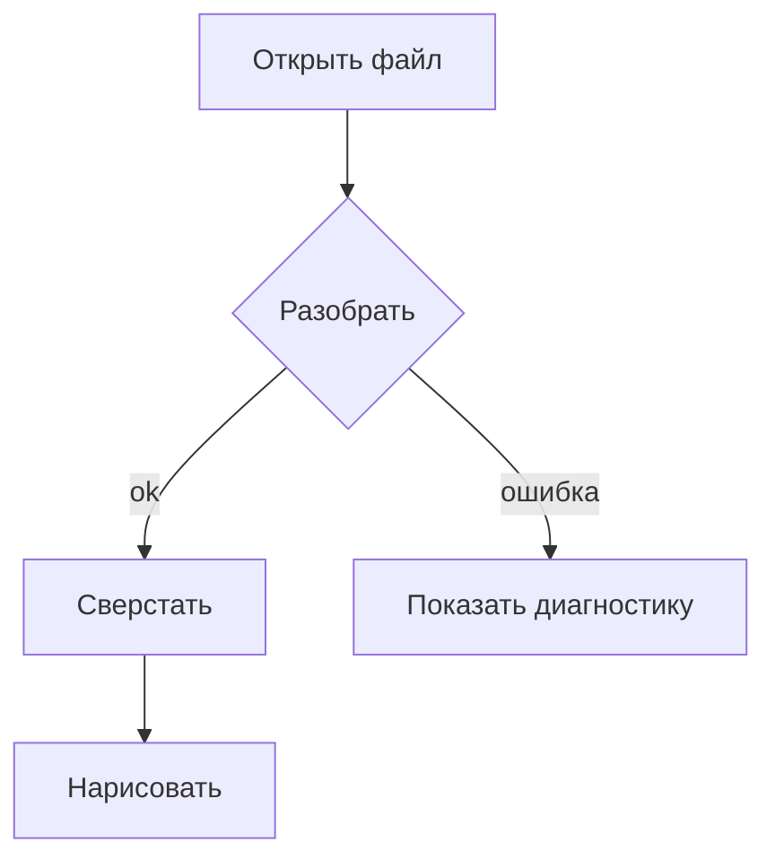
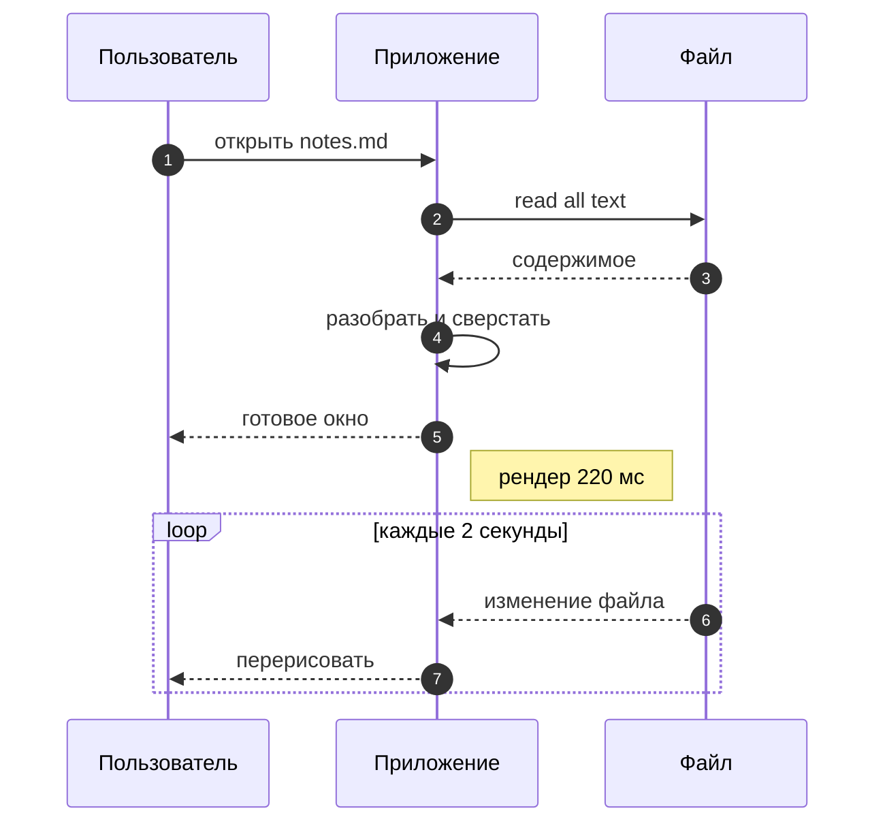
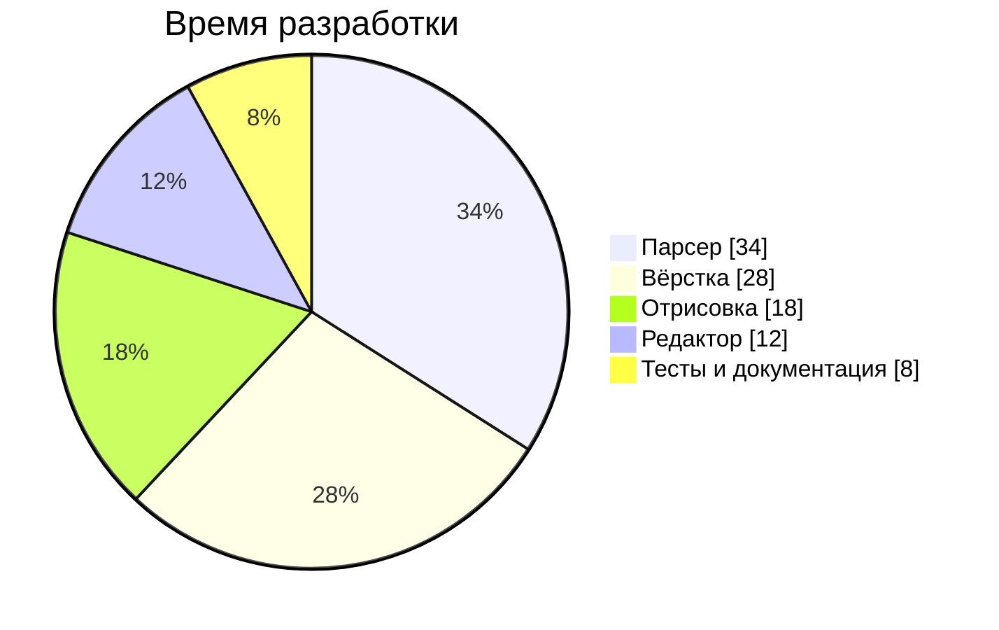
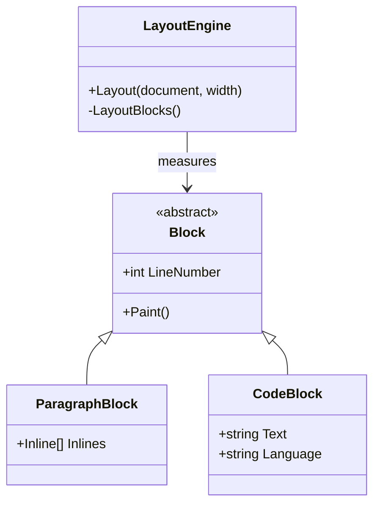
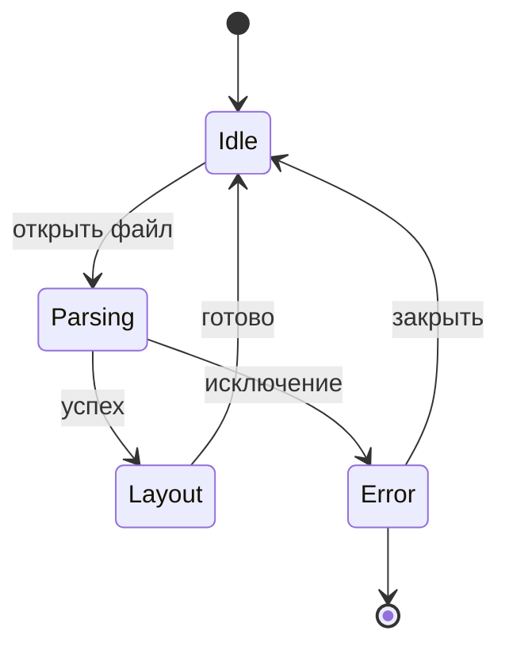
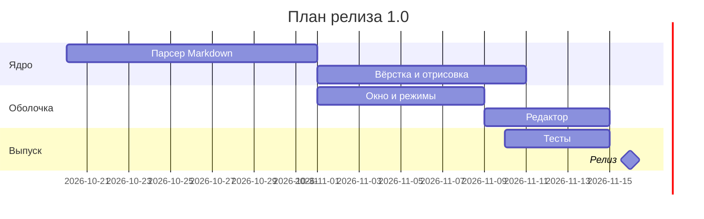
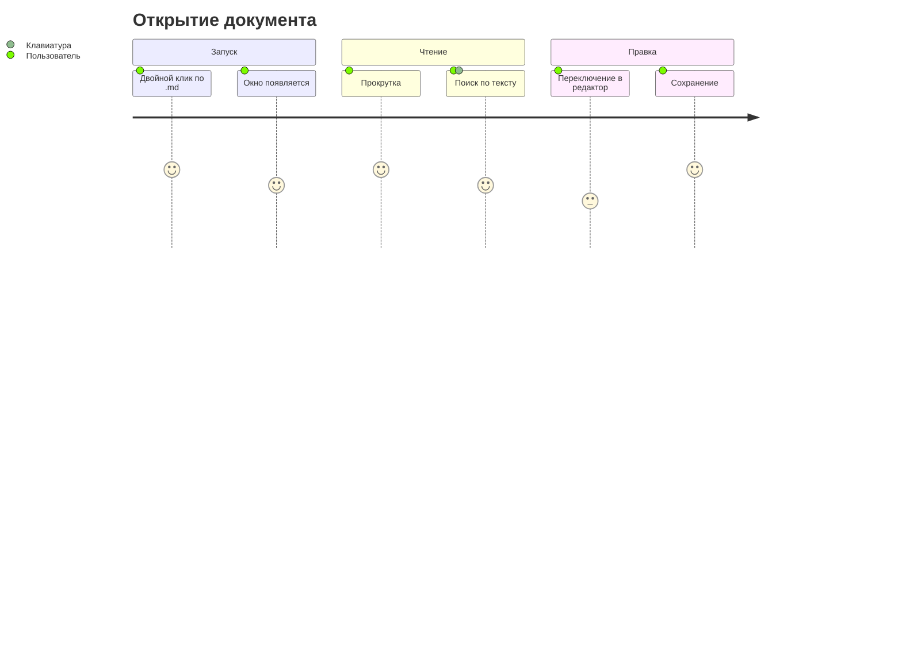
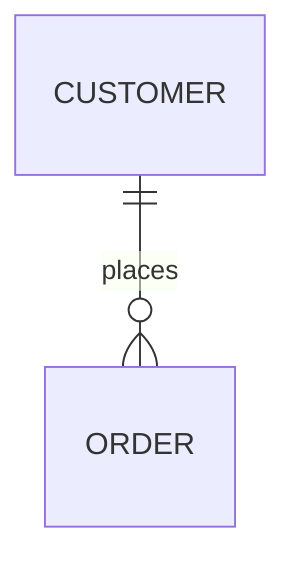

# Mermaid — всё, что поддерживается

## Блок-схема (graph / flowchart)

## Диаграмма последовательности

## Круговая диаграмма

## Диаграмма классов

## Диаграмма состояний

## Диаграмма Ганта

## Путь пользователя

## Что не поддерживается

Такие типы показываются исходником с пояснением — и никогда не ломают страницу.
